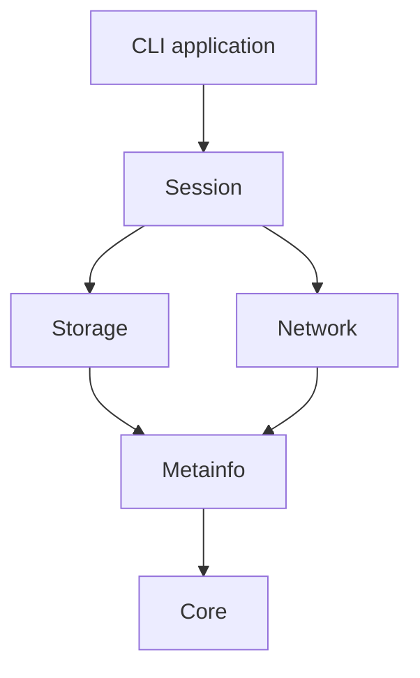

# Architecture

The project uses C++17 and small CMake targets. Public headers live under
`include/torrent/`; implementations mirror those directories under `src/`.
Includes always name their module, for example
`#include "torrent/storage/piece_manager.h"`.

## Modules

| Directory / target | Responsibility | Internal dependencies |
| --- | --- | --- |
| `core` / `Torrent::Core` | Configuration, logging, hashing, encoding, bandwidth helpers | None |
| `metainfo` / `Torrent::Metainfo` | Bencode, torrent metadata, magnet URIs and block descriptions | Core |
| `storage` / `Torrent::Storage` | Piece assembly, integrity checks, files and resume bitfields | Metainfo |
| `network` / `Torrent::Network` | Trackers, peer protocol, DHT, discovery and transports | Metainfo |
| `session` / `Torrent::Session` | Coordinate one torrent and own its workers and services | Storage, Network |
| `app` / `torrent_app` | CLI parsing, input resolution and application lifecycle | Session |

Storage and networking are independent targets. Neither depends on the CLI or
session. Tests link only the modules they exercise. Dependencies, include paths,
compiler options and optional uTP definitions are attached to their targets.
There are no global include directories or compiler definitions.

## Application flow

`app/main.cpp` calls `app::run`. The application parses and validates CLI values,
loads configuration, resolves either input form to a `TorrentFile`, and starts
one `DownloadManager`. Magnet resolution transfers its existing DHT instance
into the download session. Both input forms use the same download lifecycle.

Magnet acquisition registers a local `ut_metadata` handler before sending the
extension handshake. Outgoing requests use the remote ID; incoming responses
use the advertised local ID. `PeerConnection` owns wire headers while
`ExtensionProtocol` builds Bencode bodies, so framing is applied once.

Metadata responses contain a parsed Bencode header followed by binary bytes.
`MetadataExchange` validates sizes, indices and exact block lengths, then calls
completion handlers outside its mutex. The magnet manager verifies the raw
metadata hash before publishing a `TorrentFile`. Each peer attempt owns its
exchange state, while progress is exposed atomically. Rejected, corrupt or idle
attempts can fall back to another peer; the working tracker is retained for the
subsequent download session.

`DownloadManager` takes metadata and a `Config`, avoiding positional boolean
arguments and duplicate initialization. The configuration remains a plain value
type; no factories, dependency-injection containers or abstract service layers
are required.

## Session implementation

The coordinator's implementation is divided by responsibility:

- `download_manager.cpp`: construction, lifecycle and status.
- `peers.cpp`: peer workers and transfer processing.
- `transfer.cpp`: block acceptance, completion and remaining byte counts.
- `scheduling.cpp`: piece assignment, selection and stale-peer cleanup.
- `tracker.cpp`: announces and tracker refreshes.
- `resume.cpp`: state persistence and verification after restart.
- `discovery.cpp`: DHT, PEX, LSD, web seeds and uTP integration.
- `magnet_download_manager.cpp`: metadata acquisition before piece downloading.

The methods still belong to one session coordinator and share its state; these
translation units do not pretend to be separate services. Introduce another
class only when it owns a distinct lifecycle or invariant.

Each peer worker holds a shared owner of its peer state. Removing a peer from
the active list therefore does not destroy an object still used by its worker.
Peer threads have their own list, separate from background service threads.
The coordinator joins background workers before joining peer workers. The
session's periodic waits wake when shutdown is requested.

Peer workers select and reserve their next piece through one scheduling path.
Reservations are released after completion, verification failure or disconnect.
The scheduler reads peer bitfield snapshots protected by the session mutex.
Block acceptance, completion checks and disk commit run under one piece-manager
lock; production download paths do not retain pointers into mutable assembly
state. Announce `left` counts missing verified pieces independently of traffic
statistics.

TCP receive waits check a session cancellation callback. Shutdown is requested
before joining workers; the final verified bitfield is saved after all writers
finish.

Endgame tracks outstanding blocks in each peer's session state under the
session mutex. An idle peer first tries ordinary piece selection; only then can
it rescue an old outstanding block near completion. At most two peers hold
copies of a block. Accepted blocks remove their outstanding copies and queue
`CANCEL` commands for the corresponding workers. Workers poll idle TCP sockets,
flush cancellation/HAVE queues and mutate their own connection's request state.
Message sends are serialized so wire frames cannot interleave.

Responses without a matching outstanding session request are ignored before
assembly and statistics. Disconnect cleanup keeps partial data while another
peer still owns work for that piece. See the [endgame policy](protocols/ENDGAME.md).

## Peer protocol implementation

`PeerConnection` is organized into transport operations (`connection.cpp`),
handshakes, message decoding, outgoing messages, request tracking and protocol
extensions. It remains a concrete connection type. Network code depends on the
small metadata block description rather than the disk/piece manager.

## Development rules

- Keep code in the module that owns the data or behavior.
- Use explicit headers and CMake dependencies; avoid umbrella headers.
- Prefer a concrete function or value type over an interface with one implementation.
- Add a class when it owns state, resources or a separate invariant.
- Keep `.torrent` and magnet behavior in one application lifecycle.
- Build manual diagnostics with `BUILD_TOOLS`, examples with `BUILD_EXAMPLES`.
- Run unit tests and the offline TCP download test after structural changes.

This organization does not establish full thread safety or interoperability for
every protocol extension. The offline test checks the ordinary TCP download
path. Broader swarm behavior, encryption and optional libutp still need separate
integration coverage.
