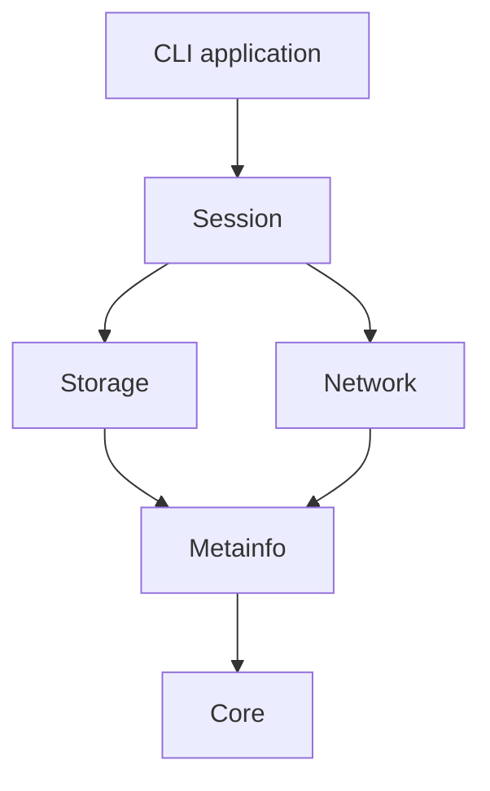

# Architecture

The project uses C++17 and small CMake targets. Public headers live under
`include/torrent/`; implementations mirror those directories under `src/`.
Includes always name their module, for example
`#include "torrent/storage/piece_manager.h"`.

## Modules

| Directory / target | Responsibility | Internal dependencies |
| --- | --- | --- |
| `core` / `Torrent::Core` | Configuration, logging, hashing, encoding, bandwidth helpers | None |
| `metainfo` / `Torrent::Metainfo` | Bencode, metadata, file-to-piece selection and block descriptions | Core |
| `storage` / `Torrent::Storage` | Piece assembly, integrity checks, files and resume bitfields | Metainfo |
| `network` / `Torrent::Network` | Trackers, peer protocol, DHT, discovery and transports | Metainfo |
| `session` / `Torrent::Session` | Coordinate one torrent and own its workers and services | Storage, Network |
| `app` / `torrent_app` | CLI parsing, input resolution and background download lifecycle | Session |
| `desktop` / `torrent_desktop` | Native Win32 controls and user interactions | App |

Storage and networking are independent targets. Neither depends on the CLI or
session. Tests link only the modules they exercise. Dependencies, include paths,
compiler options and optional uTP definitions are attached to their targets.
There are no global include directories or compiler definitions.

## Application flow

The desktop window issues commands to `app::DownloadQueue`. It owns independent
`DownloadTask` instances with stable IDs, source paths, configurations and snapshots.
The queue starts ready jobs in enqueue order up to a configurable limit. Jobs with
overlapping output files wait until the writer finishes. Stopping keeps a slot
occupied until engine cleanup completes. Removing an entry stops and unloads it
asynchronously without deleting payload data. Task port pairs are distinct so
their DHT sockets can coexist. A job that reaches `Seeding` keeps its session and
file ownership but releases its download slot. This distinction remains in place
while the seed stops, so network cleanup does not occupy a download slot again.

`NetworkSettings` validates the desktop's first port, per-torrent peer cap and
DHT/PEX flags. The queue keeps these as defaults for future sessions. Existing
entry configurations remain the settings actually used until that job starts
again; changing defaults does not mutate an active worker's captured `Config`.
New entries inherit the defaults, and restored entries use the preferences read
from `config.json`. Before loading/restarting a job, the queue chooses a port
pair that does not overlap other entries or sockets still being retired. It
keeps the old pair reserved until startup publishes the new listening port or
the worker finishes. A changed/disabled metadata DHT is destroyed on the task
worker before constructing the new session; an unchanged DHT is reused.
Preference writes also use a temporary file and atomic replacement, preserving
the previous config when writing fails.

Each running session owns a `PeerListener` on its advertised TCP port. The socket
is bound before the first announce, and a separate worker accepts connections.
Incoming handshakes run on bounded peer workers with a five-second total deadline;
one slow handshake does not block accepting others. The expected info hash comes
from the session owning that port. Both directions use `PeerConnection` and the
same session peer loop, rate limiter, request validation and verified piece state.
Both handshake directions send one initial availability message and an explicit
UNCHOKE. Fast peers receive HAVE_ALL, HAVE_NONE or BITFIELD exactly once before
any other messages. Metadata-only connections send HAVE_NONE when Fast is
negotiated; the session does not send a second availability announcement.
Upload buffers are hashed again before sending, so external file corruption is
not shared. Incoming handshake workers count toward the active peer cap; finished
workers are joined and removed during cleanup. Network handshakes do not hold the
session's peer mutex. Stop cancels handshakes and transfers, joins the accept worker,
closes the listener and drains existing incoming connections with a bounded wait.

Each task exposes an immutable file list plus a synchronized status snapshot.
The snapshot also contains copied peer and tracker diagnostics. `network_status.cpp`
reads session-owned peer fields under the peer mutex; it never reads another
worker's mutable socket/protocol state. Peer workers publish choke state and
accepted byte totals under that same mutex. The application worker copies the
result into `DownloadSnapshot`, so the desktop never accesses a live session.
Initial tracker announces run on the tracker worker, allowing the application to
publish startup diagnostics while a response is pending. Announce calls are
serialized, and shutdown joins announce workers before sending `stopped`.
The final snapshot clears active peers while retaining the last useful tracker
response/error. Starting or loading a job resets its session diagnostics.

`PeerListener::status()` checks the owned socket's `SO_ACCEPTCONN` flag and reports
the actual IPv4/dual-stack mode. The listener worker publishes this copied value
under the peer mutex, including before the first accept. Stop joins that worker
before closing the socket and publishing a stopped state. Bind failures are copied
into the task snapshot before the session is destroyed. This checks local socket
state, not public reachability; see [Winsock socket options](https://learn.microsoft.com/en-us/windows/win32/winsock/sol-socket-socket-options).
The check does not generate a peer connection or affect peer limits/statistics.
Incoming and outgoing workers count successful handshakes, incoming handshake
failures and rejections at the peer cap. Loopback evidence includes IPv4-mapped
IPv6 addresses. Non-loopback addresses are not proof of an Internet connection.

`app/network_diagnostics.cpp` produces a diagnosis and report from copied snapshot
values. It owns the shared Russian hints used by the main window and details
dialog. It distinguishes lifecycle states, missing discovery, tracker results,
choked peers and pending blocks, and includes effective limiter values without
claiming a particular firewall/NAT failure. The desktop copies the report as
Unicode only when the user clicks the copy button. Tracker credentials, paths
and query strings are omitted from the report URL. UI smoke tests render the
diagnosis without changing the user's clipboard.

`TorrentFile::trackerTiers()` preserves BEP 12 group boundaries and removes empty
and duplicate URLs. Effective groups come from `announce-list`, falling back to
the legacy URL when no usable group exists. Magnet tracker URLs form separate
ordered groups so the metadata stage's working tracker keeps its preference.
`session/tracker.cpp` owns the per-session order and acknowledgement flags; no
additional service layer is needed. Groups retain precedence, URLs are shuffled
within each group once and a successful URL is promoted only within its group.
Each announce round stops at the first successful response, including zero peers.
Periodic updates respect its interval. All-failed rounds back off for 30 seconds.

The tracker worker also sends completion; `beginSeeding()` signals it without
blocking the task owner. This lets stop cancel a pending completion request.
Per-URL flags distinguish accepted starts, attempted completion notifications and
acknowledged completions. Every registered tracker receives completion, with
failed acknowledgements left pending during seeding. After workers join,
`stopTrackers()` flushes never-attempted completion notifications and sends stopped
only to registered URLs, preferring the current tracker. These final notifications
share a two-second best-effort budget and preserve prior diagnostics. They do not
discover another tracker. HTTP uses libcurl's timeout and progress cancellation;
UDP polls a connected IPv4 socket for cancellation and a total attempt deadline.
Synchronous hostname resolution can delay shutdown. Tracker peers are merged into
the discovery queue so an empty tracker reply does not erase DHT/LSD addresses.
Shutdown changes the running predicate under the same mutex used by service
condition-variable waits, preventing a missed notification at the wait boundary.

`network/port_mapping` contains a concrete `GatewayClient` for routing, bounded
NAT-PMP UDP requests, SSDP discovery and UPnP SOAP, plus `PortMapper`, which owns
one session's finite leases and worker. TinyXML2 parses device/fault responses;
libcurl handles bounded HTTP without redirects/proxies. Device/control URLs must
remain on the selected numeric IPv4 gateway. XML/HTTP bodies are size-limited.
NAT-PMP requests are serialized within the process, validate the responding
endpoint/opcode/internal port and use zero suggested external port for deletion
as specified by [RFC 6886](https://www.rfc-editor.org/rfc/rfc6886.html#section-3.4).
UPnP supports WANIPConnection 1/2 and WANPPPConnection 1. Preflight and cleanup
queries compare the internal endpoint and per-session description token. Rules
belonging to another owner are neither replaced nor deleted. No permanent-lease
fallback or wildcard deletion is issued.

The session starts the mapper only after binding its local TCP/DHT sockets, and
keeps those sockets reserved until cleanup finishes. The worker renews at half the
granted lifetime, using a conservative request-start timestamp. Copied status
checks expiry even while a renewal request is pending. The task passes live opt-in
changes asynchronously; other network defaults retain their next-start semantics.
All router I/O stays off the window/task control thread. Disabled defaults create
no worker or discovery packets. Cleanup has a two-second best-effort budget per
session and preserves failures in status rather than claiming removal succeeded.

Tracker entries remember the port on which they registered. A mapped endpoint
change triggers stopped on the previous port and started on the new port; final
notifications use the registered endpoint even after router cleanup. DHT announces
refresh the advertised TCP port without increasing the peer-lookup frequency.
LSD continues advertising the local port. Runtime `PortMappingOptions` allow
embedding overrides and loopback emulators; they are not loaded/saved in JSON.
Only the global opt-in flag is persisted. Tests and native-window smoke modes
force loopback endpoints and never inherit the user's router opt-in.

One background worker exclusively
owns input resolution and the download session. Start, stop and close never join
network workers on the window thread. Stop persists verified pieces; continuing
creates a new session using existing files and resume data. Closing first stops
the task and then releases metadata and DHT on the worker before destroying the
window. File selections and priorities use the same `Config` fields as the CLI.
Speed limits also use the existing byte-per-second `Config` fields. Queue changes
update saved configuration and send a synchronized request to the task worker,
which applies it to the session's token buckets. The window never owns a session
pointer. Downloads share one bucket across peer and web seed delivery within a
session; uploads use a separate bucket. Waits consume large blocks incrementally,
wake when a rate changes and check shutdown while waiting. UI values use KiB/s
and convert to bytes/s without losing the precision of stored integer limits.
The queue also owns one shared `utils::BandwidthLimits` pair. It passes shared
ownership through `DownloadTask::start` to each session, including future starts
and resumes. The pair remains alive until its last session finishes. Changing a
global rate updates these thread-safe buckets directly without exposing a session
pointer to the UI or changing per-entry caps. `TokenBucket::waitAndConsume` can
charge a local and shared bucket together, locking both briefly and consuming
only the amount available in both. A slow local bucket therefore does not reserve
a whole block of the shared budget. Both locks are released during waits, with
cancellation and shared rate changes checked within 50 ms. Download and upload
use independent budgets; peer and web-seed delivery share the download path.
The existing two-second burst capacity remains, and fairness between sessions is
not guaranteed. Only payload is charged, not metadata, protocol headers or bytes
already buffered by a transport. Global limits are desktop-instance preferences
in `Config`, saved atomically before applying the update. They do not become
per-torrent settings in the saved list or affect separate CLI processes.
`SeedingOptions` validates the enabled flag, ratio and hours, and decides whether
either limit has been reached. Its elapsed-time input makes timer boundaries
testable without waiting hours. The task worker starts the timer only when all
pieces of a nonempty torrent are verified, publishes uploaded bytes and ratio,
and applies live policy updates. Empty torrents and incomplete selections finish
without seeding. Session completion announces are sent once; an already complete
resumed torrent announces `started` with `left=0` without another `completed`.
The list saves sources, destinations, file choices and the concurrency limit as
versioned JSON using a temporary file and atomic replacement. Seeding and speed
settings are saved per entry; missing seeding settings in older lists default to
stopping after download. Restored entries
resolve metadata but remain outside the download queue until the user starts them.
The original file is preserved when restoration fails. The desktop target is
Windows-only; the shared queue supports Windows and POSIX file replacement.

`app/main.cpp` calls `app::run`. The application parses and validates CLI values,
loads configuration, resolves either input form to a `TorrentFile`, and starts
one `DownloadManager`. Magnet resolution transfers its existing DHT instance
into the download session. Both input forms use the same download lifecycle.

DHT bootstrap is asynchronous and configurable through core address values.
`dht_lookup.cpp` owns one bounded iterative search with shared callback state.
Responses match both transaction ID and source endpoint. The network worker
removes transactions before invoking callbacks; announce callbacks can therefore
submit follow-up queries without locking themselves out. Cancellation closes the
lookup and drops its unfinished transactions. The existing running DHT moves from
metadata acquisition into the session; sessions without trackers use DHT directly.

Magnet acquisition registers a local `ut_metadata` handler before sending the
extension handshake. Outgoing requests use the remote ID; incoming responses
use the advertised local ID. `PeerConnection` owns wire headers while
`ExtensionProtocol` builds Bencode bodies, so framing is applied once.

Metadata responses contain a parsed Bencode header followed by binary bytes.
`MetadataExchange` validates sizes, indices and exact block lengths, then calls
completion handlers outside its mutex. The magnet manager verifies the raw
metadata hash before publishing a `TorrentFile`. Each peer attempt owns its
exchange state, while progress is exposed atomically. Rejected, corrupt or idle
attempts can fall back to another peer; the working tracker is retained for the
subsequent download session.

`DownloadManager` takes metadata and a `Config`, avoiding positional boolean
arguments and duplicate initialization. The configuration remains a plain value
type; no factories, dependency-injection containers or abstract service layers
are required.

## Session implementation

`FileSelection` maps zero-based metadata file indices to an immutable file mask
and required-piece mask. The CLI exposes one-based numbers. `PieceManager`
keeps required pieces separate from its verified bitfield: progress and
scheduling use the former; tracker totals and seed status use the latter.

`FileManager` opens only selected payload files for writing. Verified pieces
crossing skipped spans are retained in a per-torrent boundary cache. Readback
overlays actual selected-file bytes before hash verification, preventing a
valid cache from masking modified selected content. Existing skipped files can
be read without being modified when verifying earlier selections. See
[selective downloads](SELECTIVE_DOWNLOADS.md).

`FilePriority` is a small core value type. `FileSelection` resolves the explicit
selection and priority overrides into effective file priorities, storage masks
and maximum-overlap piece priorities. The same resolved selection initializes
storage and the piece manager, including the all-skipped case.

Sequential and random-first strategies apply their own ordering within the
highest eligible priority. Rarest-first compares priority before availability
count. Endgame compares priority among eligible rescue blocks. Web-seed
candidate selection reuses the sequential priority-aware selector. Priorities
can also change during a desktop session. The queue records desired choices and
retains ownership of every selected output path until the session stops. Live
updates cannot select a path owned by another active job. The task publishes a
pending flag and a revisioned request; its worker applies the latest choice
before checking completion, so an accepted update cannot be lost at the finish
boundary. Storage work never runs on the window thread.

`file_priorities.cpp` serializes selection changes against block commits, then
updates file handles and piece priorities under the session's existing peer and
piece locks. `FileManager` stages newly selected handles, verifies old boundary
data before rehydrating new spans and creates only the necessary boundary cache.
Deselected files are closed and retained. Whole skipped files are not copied into
the cache. Skipped piece assemblies are discarded; verified bits are preserved.
Outstanding session requests for wholly skipped pieces are removed and their
workers receive CANCEL commands. Limiter waits observe the new piece mask. Late
network replies cannot commit data excluded by the current selection.

The coordinator's implementation is divided by responsibility:

- `download_manager.cpp`: construction, lifecycle and status.
- `peers.cpp`: peer workers and transfer processing.
- `incoming.cpp`: listener admission and incoming handshake workers.
- `transfer.cpp`: block acceptance, completion and remaining byte counts.
- `scheduling.cpp`: piece assignment, selection and stale-peer cleanup.
- `tracker.cpp`: announces and tracker refreshes.
- `network_status.cpp`: synchronized value snapshots of peer/tracker diagnostics.
- `file_priorities.cpp`: live selection, storage transition and request cancellation.
- `resume.cpp`: state persistence and verification after restart.
- `discovery.cpp`: DHT, PEX, LSD, web seeds and uTP integration.
- `magnet_download_manager.cpp`: metadata acquisition before piece downloading.

The methods still belong to one session coordinator and share its state; these
translation units do not pretend to be separate services. Introduce another
class only when it owns a distinct lifecycle or invariant.

Each peer worker holds a shared owner of its peer state. Removing a peer from
the active list therefore does not destroy an object still used by its worker.
Peer threads have their own list, separate from background service threads.
The coordinator joins background workers before joining peer workers. The
session's periodic waits wake when shutdown is requested.

Peer workers select and reserve their next piece through one scheduling path.
Reservations are released after completion, verification failure or disconnect.
The scheduler reads peer bitfield snapshots protected by the session mutex.
Block acceptance, completion checks and disk commit run under one piece-manager
lock; production download paths do not retain pointers into mutable assembly
state. Announce `left` counts missing verified pieces independently of traffic
statistics.

TCP receive waits check a session cancellation callback. Shutdown is requested
before joining workers; the final verified bitfield is saved after all writers
finish.

Endgame tracks outstanding blocks in each peer's session state under the
session mutex. An idle peer first tries ordinary piece selection; only then can
it rescue an old outstanding block near completion. At most two peers hold
copies of a block. Accepted blocks remove their outstanding copies and queue
`CANCEL` commands for the corresponding workers. Workers poll idle TCP sockets,
flush cancellation/HAVE queues and mutate their own connection's request state.
Message sends are serialized so wire frames cannot interleave.

Responses without a matching outstanding session request are ignored before
assembly and statistics. Disconnect cleanup keeps partial data while another
peer still owns work for that piece. See the [endgame policy](protocols/ENDGAME.md).

## Peer protocol implementation

`PeerConnection` is organized into transport operations (`connection.cpp`),
handshakes, message decoding, outgoing messages, request tracking and protocol
extensions. It remains a concrete connection type. Network code depends on the
small metadata block description rather than the disk/piece manager.

## Development rules

- Keep code in the module that owns the data or behavior.
- Use explicit headers and CMake dependencies; avoid umbrella headers.
- Prefer a concrete function or value type over an interface with one implementation.
- Add a class when it owns state, resources or a separate invariant.
- Keep `.torrent` and magnet behavior in one application lifecycle.
- Build manual diagnostics with `BUILD_TOOLS`, examples with `BUILD_EXAMPLES`.
- Run unit tests and the offline TCP download test after structural changes.

This organization does not establish full thread safety or interoperability for
every protocol extension. The offline test checks the ordinary TCP download
path. Broader swarm behavior, encryption and optional libutp still need separate
integration coverage.
